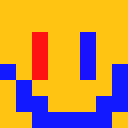

<div align="center">



# NobodyTheKat

**A tiny Minecraft-style personal site, built with plain HTML and CSS.**

[**nobodythekat.github.io**](https://nobodythekat.github.io)

</div>

## About

Hi, I'm NobodyTheKat. I like using cybersecurity basics like `nmap` and Kali, and I play video games like Minecraft and Roblox. This repo is the source of my personal page, which collects all my links in one place.

## Project structure

```
.
├── index.html            # page markup
├── css/
│   └── style.css         # all styles
├── assets/
│   ├── nobodyhead.png    # pixel-art avatar and favicon
│   ├── cursor.png        # diamond axe cursor
│   └── minecraft.woff2   # Minecraft font
├── .well-known/
│   └── discord           # Discord domain verification
├── .nojekyll             # lets GitHub Pages serve dot-folders
└── README.md
```

## Run locally

```bash
git clone https://github.com/NobodyTheKat/NobodyTheKat.github.io.git
cd NobodyTheKat.github.io
python3 -m http.server 8000
```

Then open <http://localhost:8000>.

## Customize

- **Links and text:** edit `index.html`. Each link is one `<a class="slot">` block.
- **Colors and layout:** edit the variables at the top of `css/style.css`.
- **Cursor:** replace `assets/cursor.png` (max 128×128 px). The hotspot is set in `css/style.css` (`3 4`, the tip of the axe).

## Deploy

The site is served by GitHub Pages straight from the `main` branch, root folder. Every push goes live in about a minute.

## Credits

- Font: [typeface-minecraft](https://github.com/South-Paw/typeface-minecraft) by South-Paw
- Cursor: *Minecraft Enchanted Diamond Axe* from SweezyCursors

Minecraft is a trademark of Mojang AB. This project is a fan page and is not affiliated with Mojang or Microsoft.
